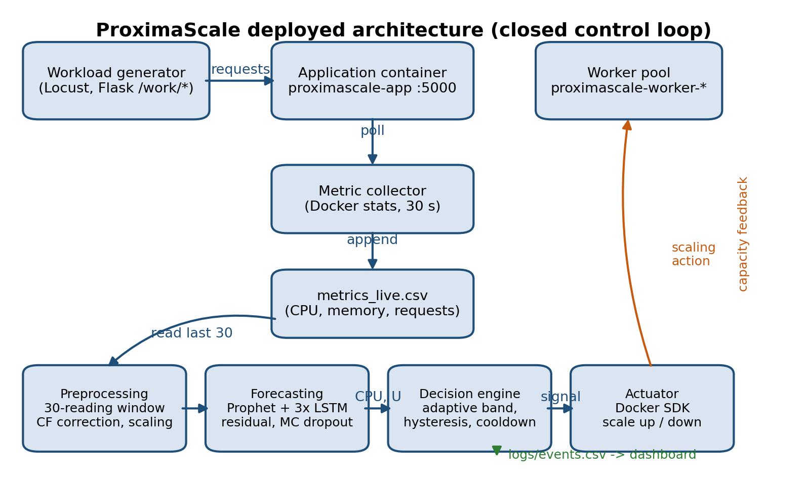
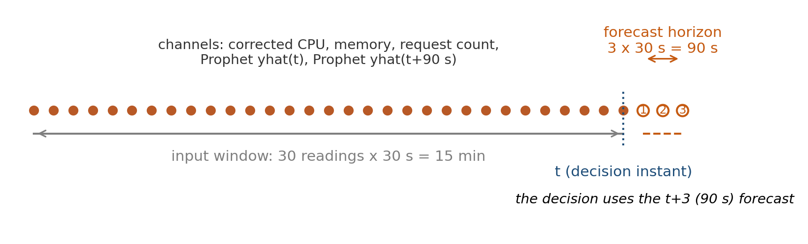
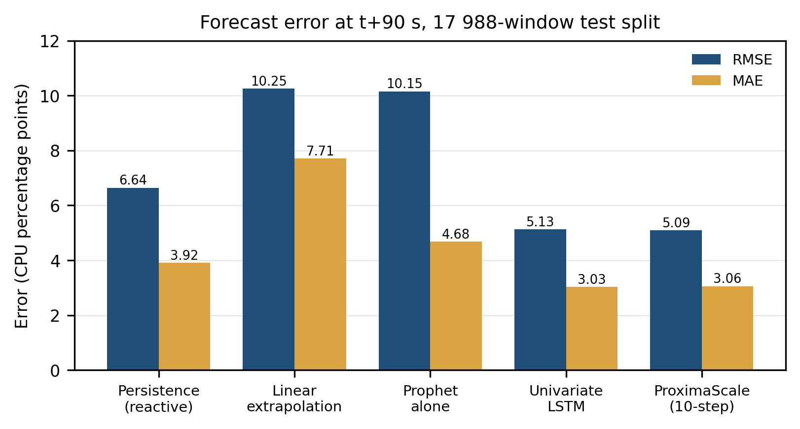
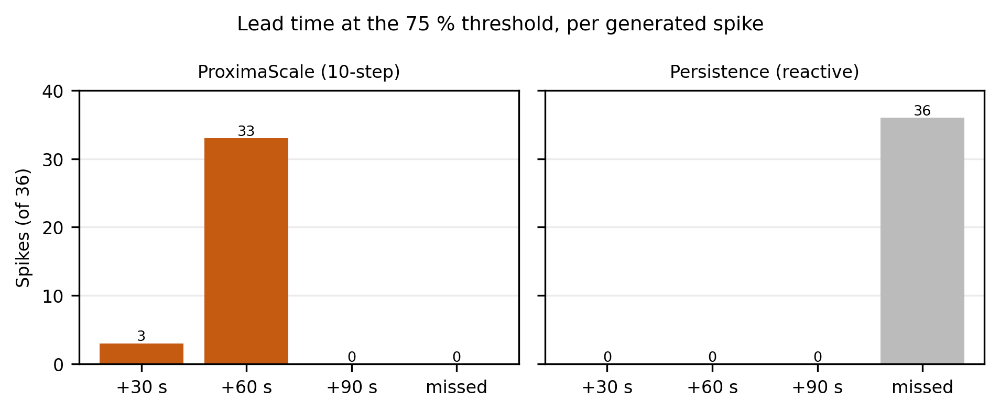
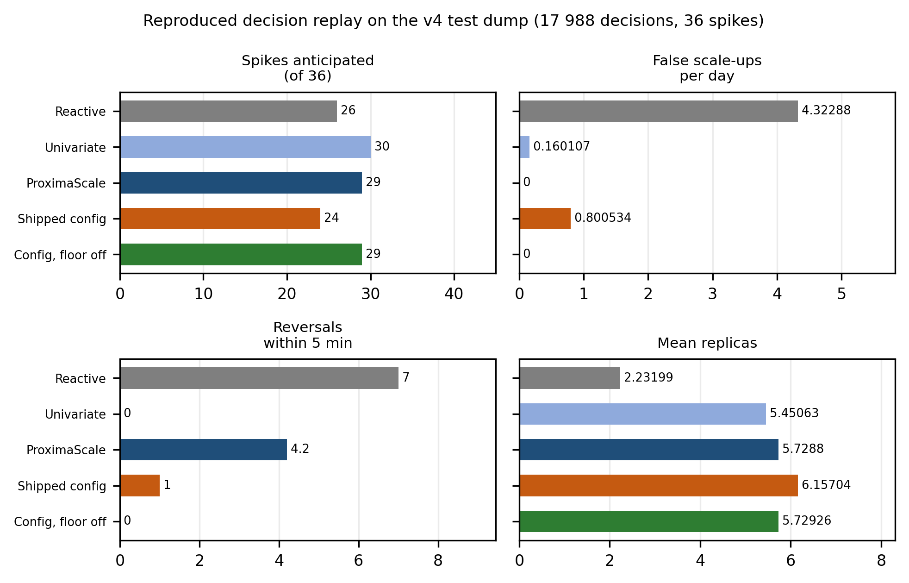
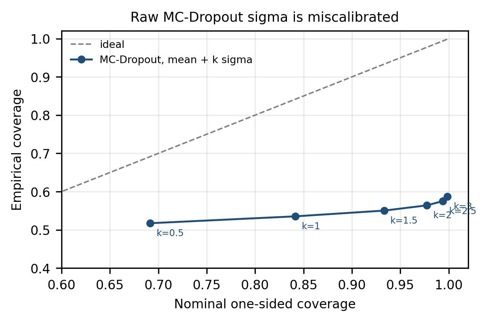

# ProximaScale: An Integrated Uncertainty-Aware and Feedback-Driven Framework for Proactive Auto-Scaling of Cloud Applications

*Prof. Vinaya S Kavalgi, Assistant Professor, Department of Computer Science (AI & ML), AMC Engineering College, Bengaluru, India — vinaya.kavalgi@amceducation.in*  
*Shreyas R, Department of Computer Science (AI & ML), AMC Engineering College, Bengaluru, India — 1am23ci141@amceducation.in*  
*Shashank B, Department of Computer Science (AI & ML), AMC Engineering College, Bengaluru, India — 1am23ci138@amceducation.in*  
*Shravani V, Department of Computer Science (AI & ML), AMC Engineering College, Bengaluru, India — 1am23ci140@amceducation.in*  
*Soubhagya Ranjan Behera, Department of Computer Science (AI & ML), AMC Engineering College, Bengaluru, India — 1am23ci148@amceducation.in*  

**Abstract** - Cloud applications experience dynamic and unpredictable workloads, which makes reactive auto-scaling prone to acting only after resource demand has already risen. This paper presents ProximaScale, a proactive auto-scaling framework for containerized applications that combines statistical and neural workload forecasting with an explicit, auditable scaling policy. The served forecaster is a residual-stacking model: Facebook Prophet models trend and seasonality of container CPU utilization, and a two-layer Long Short-Term Memory (LSTM) network, fed with a 30-reading window of corrected CPU, memory, request count and two Prophet channels, predicts Prophet's residual for the next three 30-second steps. Three independently seeded LSTMs are pooled into a Monte Carlo dropout ensemble of 30 stochastic passes per decision. The point forecast is re-anchored on the measured CPU level, and a split-conformal, sigma-binned upper bound provides a one-sided risk estimate. A decision engine combines an adaptive threshold band, a cooldown gate and scale-down guards to issue scale-up, hold and scale-down actions, which a Docker actuator executes on a worker pool. On a 90,000-row, 31-day synthetic workload with 36 generated spikes, the served model attains an RMSE of 4.35 and an MAE of 2.68 CPU percentage points at a 90-second horizon, against 10.15/4.68 for Prophet alone, 5.13/3.03 for a univariate LSTM and 6.64/3.92 for a reactive persistence signal; the improvement is significant under a Diebold-Mariano test (p < 1e-9). Mean lead time over spike onsets is 58.2 s against a feasible ceiling of 58.3 s, and 33.8 of 36 spikes are anticipated 90 s ahead under the forecast-mean policy with no false scale-up episodes per day, while the shipped configuration, which enables a reactive floor, anticipates 24 of 36. We also report negative results that qualify the framework's claims: raw Monte Carlo dropout variance is strongly miscalibrated (mean + 2 sigma covers 55-63% at nominal 84-99.9%), the configured counterfactual blend weight is not optimal on held-out post-scaling rows, and two internal evaluation harnesses disagree on decision-level outcomes. The study therefore establishes forecast-quality and lead-time benefits on synthetic data, while leaving SLO-level and real-traffic benefits unestablished.

*Keywords* - proactive auto-scaling, cloud applications, workload forecasting, residual stacking, LSTM, Prophet, uncertainty calibration, feedback control, Docker

## I. Introduction

Cloud applications operate under continuously changing workloads, and variations in user demand translate into fluctuating computational resource requirements. Auto-scaling addresses this by adjusting capacity according to workload conditions. Conventional reactive mechanisms, including threshold rules and the Kubernetes Horizontal Pod Autoscaler, act on current or recently observed utilization. A scaling action therefore begins only after a workload increase has already produced elevated resource consumption, and container start-up and readiness latency is spent inside the overload interval rather than before it.

Predictive auto-scaling attempts to remove that delay by forecasting future workload and acting before the predicted demand arrives. Statistical models such as Prophet capture trend and seasonality; recurrent networks capture short-range non-linear dynamics. Forecasts are, however, uncertain, and the uncertainty is not uniform: a model that is accurate under regular diurnal load may be least reliable precisely at abrupt transitions. A scaling policy that treats every forecast as equally trustworthy can therefore provision too early, too late, or repeatedly.

Prediction alone is also insufficient as a control strategy. A deployed autoscaler must observe what happened after an action, because the action itself changes the measured signal: adding capacity depresses CPU utilization, so post-scaling observations are a mixture of workload and intervention. If such observations are used naively for training or for the next decision, the controller learns to under-react to the spikes it exists to absorb. This motivates a closed monitoring-decision-actuation loop with explicit treatment of post-scaling data.

This paper reports the current state of ProximaScale, an implementation-led study rather than a proposal. The repository contains a working pipeline: a Flask workload container measured through the Docker API, a collector that separates "no CPU used" from "could not measure", a residual-stacking forecaster served from a versioned model bundle, a decision engine with adaptive thresholds and hysteresis, a Docker actuator, a decision log, and a Streamlit dashboard. The paper is written against that implementation and against results that the repository can regenerate; where earlier drafts of this work reported figures that the current code does not reproduce, the reproduced figures are used and the discrepancy is stated.

The contributions of this version are:

- A residual-stacking forecaster in which Prophet's value at each historical reading and 90 s ahead are supplied to the LSTM as input channels, so the network models the residual conditional on the statistical forecast rather than forecasting CPU in isolation.
- A served uncertainty path with two distinct mechanisms, reported separately: a pooled Monte Carlo dropout ensemble over three seeded LSTMs, and a split-conformal, sigma-binned one-sided bound calibrated on a validation period.
- A decision layer whose components are ablated on a 17,988-decision replay: adaptive band, cooldown, reactive floor, anomaly bypass, upper-bound branch, and scale-down guard.
- An empirical evaluation on a frozen 90,000-row synthetic workload with a generator-derived ground truth, including lead-time analysis against a computed feasibility ceiling, Diebold-Mariano tests with moving-block bootstrap intervals, and out-of-distribution tests on three unseen one-week workloads plus the only real container data in the repository.
- A candid account of negative and inconclusive findings: miscalibrated raw dropout variance, a suboptimal counterfactual weight, disagreement between two evaluation harnesses, and the absence of any measured end-to-end latency benefit because the actuator operates in pool mode without a load balancer.

Section II reviews related work. Section III describes the deployed architecture, Section IV the forecasting model and its calibration, Section V the experimental protocol, Section VI the results, and Sections VII-IX the discussion, threats to validity, and conclusions.

## II. Related Work

Research on cloud auto-scaling has moved from reactive rules toward predictive and learned policies. The studies most relevant to ProximaScale fall into four groups.

### A. Deep Learning-Based Auto-Scaling

Dang-Quang and Yoo proposed a multivariate auto-scaling framework built on a bidirectional LSTM within a monitor-analyze-plan-execute loop [1]. Using several workload variables rather than a single request-rate series, their framework reported lower prediction error than univariate and alternative recurrent baselines. Suleiman et al. extended single-step prediction to multi-step LSTM forecasting for web-application workloads, motivated by the observation that provisioning decisions require a horizon rather than a point [2]. Golshani and Ashtiani treated proactive scaling as a sequence-modelling problem with temporal convolutional networks and coupled prediction to a multi-criteria decision mechanism, evaluating prediction error, service-level violations and under-utilization together [3].

These studies establish that recurrent and convolutional models capture short-range workload dynamics. They also show that prediction accuracy is not by itself a scaling policy: the mapping from forecast to action, and the treatment of forecast error, remain design decisions.

### B. Hybrid Statistical-Neural Forecasting

Guruge and Priyadarshana combined Facebook Prophet and LSTM to forecast HTTP request workloads for Kubernetes pod scaling, reporting improvements over single-model forecasters and over the default horizontal autoscaler [4]. Their combination is a hybrid predictor in which the two models contribute complementary estimates. ProximaScale differs in the role assigned to each model: Prophet supplies a baseline and is also an input channel, while the LSTM is trained only on Prophet's residual, so the network's target is the part of the signal the statistical model does not explain. An earlier weighted-average blend was implemented in this project and abandoned because it could not outperform the LSTM alone; that module remains in the repository as a deprecated record.

### C. Alternative Sequence Architectures

Arbat et al. proposed a Wasserstein adversarial Transformer for cloud workload prediction, reporting faster inference and improved accuracy relative to an LSTM baseline on real traces, and demonstrating predictive VM auto-scaling [5]. Such results show that architectural choice matters for both accuracy and inference cost. They do not remove the question addressed here: how much confidence a controller should place in a given forecast at a given moment.

### D. Learned Scaling Policies

Agarwal, Rodriguez and Buyya applied deep recurrent reinforcement learning to serverless function auto-scaling, modelling the partially observable environment and comparing learned policies with threshold-based autoscaling [6]. Learned policies can adapt without hand-tuned thresholds, at the cost of training infrastructure, reward design and reduced auditability. ProximaScale retains an explicit, inspectable decision rule and uses learning only for forecasting and uncertainty estimation, which suits deployments in which each scaling action must be explainable after the fact.

### E. Uncertainty Quantification and Calibration

Monte Carlo dropout interprets dropout at inference time as approximate Bayesian inference, yielding a predictive mean and variance from repeated stochastic passes [7]. The technique is attractive because it requires no separate probabilistic model, but its variance is only meaningful if it is calibrated against observed errors. Split conformal prediction provides distribution-free coverage guarantees under exchangeability by calibrating a residual quantile on held-out data [8], and is used here for the served upper bound. Forecast comparisons are tested with the Diebold-Mariano statistic using a heteroskedasticity- and autocorrelation-consistent variance estimate [9].

### F. Research Gap

The reviewed work establishes accurate forecasters and, separately, scaling policies. Three gaps remain. First, forecast uncertainty is often asserted rather than calibrated and reported: a variance estimate that is not tested for coverage cannot justify risk-aware scaling. Second, post-scaling observations are rarely corrected for the controller's own effect, even though they bias subsequent learning. Third, evaluations frequently report aggregate error without a feasibility ceiling for lead time, which makes a 60-second lead time look equally achievable on fast and slow workload ramps. This paper addresses all three explicitly, and reports where the implementation still falls short.

## III. Proposed System

### A. System Overview

ProximaScale is organized as a closed control loop (Fig. 1). A workload generator drives a Flask application container. A separate collector process samples that container's resource usage through the Docker API at a fixed interval, obtains the workload request count from an HTTP endpoint exposed by the application, and appends one row per poll to a monitoring CSV. The control loop reads the most recent 30 rows, constructs the model input, obtains a point forecast and an upper bound, evaluates a decision, and asks the actuator to add or remove worker containers. Every decision is written to an event log consumed by a dashboard.

*Fig. 1. Deployed ProximaScale architecture. Solid arrows are data flow within one decision cycle; the orange path is the capacity change that closes the loop. Workers are a resource pool; no load balancer distributes requests to them (Section III-F).*

### B. Monitoring and Measurement

The collector polls once every 30 s, matching the sampling interval on which every model was trained. Container CPU is computed from the difference between two Docker statistics snapshots taken two seconds apart, scaled by the number of online CPUs and capped at 100%. The two-snapshot difference is necessary because a single snapshot's fields are relative to Docker's cached previous call, which is stale on the first call and after idle periods; using one snapshot produced readings alternating between 0.01% and 100% in earlier versions.

Request activity is counted inside the application and read-and-reset atomically by the collector through POST /request-rate/reset, which also reports the wall-clock length of the window it measured. The CSV field is therefore a count per polling window, not a rate; the collector prints the derived rate alongside it. Monitoring endpoints are excluded from the count so that the measurement does not observe itself.

The collector distinguishes four situations that a naive implementation conflates: zero CPU usage, a missing CPU field, a container that is not running, and a Docker or network failure. Only the first is written as 0.0; the others produce no row and a log entry. A missing measurement must not enter the model as a value, and the control loop's staleness check detects the resulting gap: if the newest row is older than three poll intervals, the cycle is skipped with a warning instead of scaling on stale data.

### C. Residual-Stacking Forecasting

The forecasting component (Fig. 2) combines Prophet and an LSTM in a residual-stacking arrangement. Prophet models trend and daily/weekly seasonality of CPU utilization and provides a fitted value for every timestamp in the window plus a forecast for the next three steps. The LSTM receives the 30-reading window of corrected CPU, memory utilization, request count, Prophet's fitted value at each reading's timestamp, and Prophet's forecast 90 s after each timestamp. Its target is the residual between the corrected CPU and the Prophet fitted value for the next three readings. The final forecast is the sum of Prophet's forecast and the predicted residual.

Supplying Prophet's values as input channels, rather than only adding its output at the end, was selected by validation-period model search over more than twenty variants. It lets the network condition its correction on where the statistical model believes the series is and where it believes it is going, which matters at spike onsets where Prophet lags.

*Fig. 2. Served forecasting stack. Prophet's fitted value at each reading and its forecast 90 s ahead enter the LSTM as input channels; the network predicts the residual, which is added back to Prophet's forecast. Thirty stochastic passes are pooled across three seeded members.*

### D. Uncertainty and Anomaly Awareness

Two mechanisms produce the risk signal. Dropout layers are kept active at inference and 30 stochastic forward passes are pooled across three independently seeded models, giving a predictive mean and standard deviation for each horizon step. Separately, a split-conformal procedure calibrates a one-sided upper bound on a held-out validation period: residuals are normalized by the predicted standard deviation, binned into sigma-quantile bins, and a per-bin margin is chosen so that the resulting bound covers the requested fraction of validation targets. The served bundle uses the calibrated 95% bound; the raw mean-plus-two-sigma rule remains available and is the default in the legacy single-model path.

Anomaly awareness is a rolling z-score of the latest corrected CPU reading relative to the preceding nine readings, with an absolute floor of 5% CPU so that idle jitter cannot be flagged as a spike whatever its z-score. The flag is available to the decision engine but, as Section VI-H shows, its precision on this workload is low and it is switched off in the served configuration.

### E. Adaptive Decision Engine

The decision engine converts the forecast into one of three actions: scale_up, scale_down or hold. Thresholds are adaptive: the upper and lower triggers are the mean of the last 30 predictions plus or minus 1.5 standard deviations, clamped into operator-controlled windows (60-90% for the upper trigger, 15-45% for the lower) and separated by at least 10 percentage points so that the band cannot invert. Until ten predictions exist, the static thresholds from configuration (75% and 30%) apply. The decision rule is

> a_t = scale_up   if  (u_t > U_t  and  not cooling down)  or  (anomaly bypass enabled and flagged)

> a_t = scale_down if  u_t < L_t  and  c_t <= 75  and  not cooling down

> a_t = hold       otherwise

where u_t is the forecast at the 90 s horizon, U_t and L_t are the effective upper and lower thresholds, and c_t is the current measured CPU. Cooldown is a 180 s hysteresis window armed only after a successful actuation; an unavailable actuator or a rejected action at the replica limit does not arm it. Two optional branches exist and are disabled in the served configuration: an anomaly bypass that scales up regardless of the forecast, and an upper-bound branch that scales up when the calibrated bound alone exceeds U_t. A reactive floor raises capacity when the current reading already exceeds U_t; it is enabled in the shipped configuration file, although the tuning documentation states it was rejected, a discrepancy analysed in Section VI-E.

### F. Container-Based Actuation

The actuator uses the Docker SDK to create or remove worker containers from the same image as the application, each limited to 0.5 CPU and 256 MB, with a health check and a bounded readiness wait. Replica counts are read back from Docker rather than tracked internally, so a failed creation cannot desynchronize the fleet. Scale-down removes the newest worker by default; the strategy is configurable. The minimum is one worker and the maximum is ten.

An important architectural limitation must be stated plainly: in the default pool mode the workers do not receive application traffic. No load balancer or service proxy is installed, and the actuator reports traffic_serving separately, as false. Adding workers therefore increases available capacity but does not reduce the latency of requests that continue to reach the original container. This is why this paper reports forecast, lead-time and decision-level metrics, and does not report an end-to-end latency improvement.

### G. Feedback Mechanism

Feedback enters the system at two points, and the paper distinguishes them because earlier descriptions of this work conflated them. The online feedback is the monitoring loop itself plus delta calibration: the served forecast is re-anchored on the measured current CPU, so the measured state continuously corrects the model's absolute level. The offline feedback is the counterfactual correction applied to post-scaling rows before training and inference. There is no online learning: model weights are not updated at runtime.

Delta calibration exists because the committed Prophet artifact was fitted on a synthetic series whose baseline is near 50% CPU, whereas a real container idles near 0-1%. The model's learned change over 90 s transfers; its absolute level does not. The served prediction is therefore current CPU plus the model's forecast delta, with a 1 percentage-point deadband to suppress jitter. The mechanism is documented in the code and is observable in the event log's forecast_mode column.

### H. End-to-End Operation and Guardrails

Each cycle reads the last 30 rows, builds the input, predicts, decides, actuates and logs. Several guardrails make failure modes explicit rather than silent. Forecasts and bounds are clamped to the physical 0-100% CPU range while preserving their order. If any component of the prediction pipeline raises, the function returns a conservative overshoot of the measured CPU (1.15x for the mean, 1.3x for the bound) with the anomaly flag false, and the event log records forecast_mode as fallback; a broken model can never masquerade as a detected spike. SHAP attribution is computed on scale-ups using the same scaled window that produced the prediction, and a failure there records zeros rather than terminating the loop.

## IV. Residual-Stacking Prediction Model

### A. Input Window and Forecast Horizon

The served model consumes 30 consecutive readings at 30 s spacing, i.e. 15 minutes of history (Fig. 3). Each reading contributes five channels: counterfactually corrected CPU utilization, memory utilization, request count for the polling window, Prophet's fitted value at that timestamp, and Prophet's forecast 90 s after that timestamp. The prediction target is CPU utilization three steps ahead:

> x_t = [ c_tau, m_tau, r_tau, p_tau, p_tau+3 ]  for tau = t-29, ..., t   (1)

> y_hat(t+k) = f(x_t),   k = 1, 2, 3                                (2)

The decision uses the third step, i.e. the forecast 90 s ahead. Three steps is the widest horizon at which the committed artifacts were trained and validated; longer horizons were not evaluated and are not claimed.

*Fig. 3. Input window and forecast horizon. The model sees 15 minutes of five-channel history and emits three residual steps; the controller acts on the third.*

### B. Prophet Baseline

Prophet decomposes the series into trend, seasonality and residual components and is fitted once on the training period [10]. For a window ending at time t it supplies fitted values at the window's own timestamps and forecasts at t+1, t+2 and t+3. Anchoring the forecast to the window's last timestamp, rather than to the end of Prophet's training data, was a correctness fix: the earlier implementation forecast forward from the training boundary, producing meaningless timestamps for live windows.

> p(t+k) = Prophet(t+k),   k = 0, 1, 2, 3                            (3)

### C. Residual Construction

The residual is the difference between the corrected CPU and Prophet's fitted value at the same timestamp:

> e(t) = c_corrected(t) - p(t)                                      (4)

The LSTM is trained to predict e(t+1), e(t+2), e(t+3) from the window. Its task is therefore not to reproduce the seasonal structure, which Prophet already models, but to anticipate the part of the series that the statistical model misses, which on this workload is dominated by spike onsets.

### D. LSTM Architecture and Training

Each ensemble member is a two-layer LSTM with 64 and 32 units, dropout 0.1 after each layer, and a dense output of three residual values, totalling 30,435 trainable parameters. Training uses mean squared error, Adam with a learning rate of 1e-3, batch size 32, a maximum of 50 epochs and early stopping with patience 5, restoring the best weights. The training set is the first 80% of the frozen 90,000-row dataset (of which the final 10% serves as validation); the models served in the bundle were additionally trained on a variant dataset in which every spike has a randomized ramp, hold and decay shape, which improved robustness to spike shapes not present in the original generator.

Three members are trained with seeds 0, 1 and 2, and their stochastic passes are pooled. A decision therefore costs 30 forward passes in total (ten per member), preserving the uncertainty budget of the original single-model 30-pass design while reducing the variance contribution of any one initialization.

### E. Final Forecast

The point forecast adds the predicted residual to Prophet's forecast:

> y_hat(t+k) = p(t+k) + e_hat(t+k)                                  (5)

### F. Live Calibration

The served point forecast is re-anchored on the measured CPU. Let p(t) be Prophet's value at the window's last timestamp, e_hat(t+1) the model's first residual step as a proxy for the residual now, and c(t) the measured CPU. Then

> delta_t = c(t) - [ p(t) + e_hat(t+1) ]                             (6)

> y_calibrated(t+k) = y_hat(t+k) + delta_t,   k = 1, 2, 3            (7)

Equivalently, the prediction equals the measured CPU plus the model's forecast change over the horizon. The offset is held within a 1 percentage-point deadband to suppress jitter but is applied immediately to larger changes; smoothing a genuine 0-100% transition would be worse than a visible step. The mode is recorded per decision, and setting the environment variable PROXIMASCALE_LIVE_CALIBRATION=off restores the uncalibrated absolute output.

### G. Calibrated Upper Bound

For the served bundle the upper bound is a split-conformal estimate. On the validation period, standardized residuals z = (y - mean)/sigma are formed for every window; sigma is divided into quintile bins by its own quantiles, and for each bin b the margin q_b is the 95th percentile of z within that bin. At inference,

> U(t+k) = y_hat(t+k) + q_bin(sigma(t+k))                            (8)

This construction targets 95% one-sided coverage overall. Section VI-J shows that it achieves 94.9% overall but only about 87% on targets above 75% CPU, and that the underlying raw sigma is poorly informative; the calibrated bound should therefore be read as a marginal, not a conditional, guarantee.

### H. Counterfactual Correction of Post-Scaling Rows

Rows collected immediately after a scaling event are marked post_scaling. For each contiguous run of such rows, the baseline is the last pre-scaling value, and the corrected value is a fixed blend:

> c_corrected = 0.6 * c_observed + 0.4 * c_baseline                    (9)

The blend is not a full reversion: scaling has a real effect, so the observed value retains the majority weight. Section VI-G evaluates this choice against the generator's noiseless true load and finds 0.2 to be a better weight on the available post-scaling rows, so 0.6 is a design choice that the evidence does not support as optimal.

**TABLE I. Parameters of the served implementation (bundle proximascale_v4)**

| Parameter | Value | Source |
|---|---|---|
| Sampling interval | 30 s | monitoring/collector.py (POLL_INTERVAL) |
| CPU measurement | two Docker stats snapshots, 2 s apart | monitoring/metrics.py |
| Input window | 30 readings (15 min) | model/saved/proximascale_v4/config.json |
| Input channels | 5 (CPU, memory, requests, Prophet t, Prophet t+3) | config.json |
| Forecast horizon | 3 steps (90 s) | config.json |
| LSTM | 64 / 32 units, dropout 0.1, dense 3 | seed*/info.json |
| Trainable parameters | 30,435 per member | seed*/info.json |
| Ensemble | 3 seeds x 10 MC passes = 30 passes | config.json |
| Upper bound | split-conformal, sigma-binned, 95% | config.json (upper_bound) |
| Decision band | rolling 30 forecasts, k = 1.5 | config.yaml |
| Band clamps | upper 60-90, lower 15-45, min width 10 | config.yaml |
| Cooldown | 180 s | config.yaml |
| Replicas | min 1, max 10; 0.5 CPU and 256 MB each | config.yaml |
| Reactive floor | enabled (scale_up_on_current_cpu: true) | config.yaml |
| Anomaly bypass / upper-bound branch | disabled / disabled | config.yaml |
| Scale-down guard | no scale-down while current CPU > 75% | config.yaml |

## V. Experimental Setup

### A. Datasets

The primary dataset is a frozen synthetic series of 90,000 rows at 30 s spacing (31 days, 2026-09-19 to 2026-10-20) produced by the repository's generator with a fixed seed. It contains daily and weekly seasonality, 180 non-overlapping CPU spikes with a 3-row ramp, 14-row hold and 3-row decay, memory correlated with CPU, request counts correlated with CPU and time of day, and 1,800 post-scaling rows marked after each spike. Utilization spans 5.0-93.6% CPU (mean 36.0, 95th percentile 62.5), 23.1-81.5% memory and 12-1,446 requests per 30 s window. The generator retains its latent noiseless series and per-row regime labels (normal, ramp, hold, decay, post-scaling), which are used only for analysis, never as model inputs.

A second synthetic series of the same length and base process randomizes every spike's shape (ramp 30 s to 4 min, hold 2-8 min, decay 30 s to 4 min, peak 75-95%, gaps 75 min to 6.7 h). It is used for training the served bundle and, in its own held-out split, for checking that improvements are not specific to one spike shape.

Three unseen one-week series were generated after the primary series ends, with generator parameters fixed before any result on them was inspected: fresh (same generator, different seed), shifted (3-minute ramps, doubled spikes) and shifted2 (2.5-minute ramps, 1.5x spikes). The only real data in the repository are 121 rows collected from the Docker application over two days in September 2026 at roughly 63 s spacing, during which the container was essentially idle. All synthetic results therefore demonstrate pipeline coherence, not real-traffic behaviour.

### B. Splits and Protocol

The primary series is split chronologically: the first 80% is training data, of which rows 64,800-71,999 form the validation period used for early stopping, model selection, bound calibration and engine tuning. Rows 72,000 onward are the test split: 17,988 windows, corresponding to 6.25 days, containing 36 spike onsets above the 75% threshold. Choices were fixed on validation; the test split was scored after each choice was finalized.

The published 10-reading model of the earlier version of this work used the test split for early stopping. To allow a like-for-like comparison, a second family of 10-reading models was retrained with early stopping on validation (the fair protocol). Results from both are reported where they differ.

### C. Baselines

Five forecasters are compared. Persistence uses the current CPU as the forecast, which is the signal a reactive threshold scaler acts on. Linear extrapolation extends the slope of the last three readings three steps. Prophet alone uses the statistical model without a residual correction. The univariate LSTM is a single-input recurrent model without Prophet channels. ProximaScale denotes the served residual-stacking model; the earlier 10-reading hybrid is reported separately as ProximaScale (10-step).

### D. Metrics

Forecast error is RMSE and MAE over all test windows at the 90 s horizon, in CPU percentage points. An event is a target row above 75%; at the window level, precision, recall and F1 treat a forecast above threshold as an alarm and a false alarm episode as a run of consecutive alarm windows that overlaps no above-threshold target, reported per day. Lead time for a spike onset is (onset - t) x 30 s for the earliest window in the three windows preceding the onset whose forecast exceeds the threshold, and zero if none does. Because no input changes before a spike's first ramp row, no forecast made earlier can be informed; the feasible ceiling is therefore min(onset - ramp start, 3) x 30 s, which is 58.3 s on average for this test split. Crossings count changes in the alarm state; they are split into spurious and missed crossings by one-to-one matching within three windows.

Uncertainty is evaluated by one-sided coverage, the share of windows whose 90 s target lies below the upper bound, and by the Spearman correlation between predicted sigma and absolute error. Differences against each baseline are tested with the Diebold-Mariano statistic using Newey-West variance at lags 2 and 60, with moving-block bootstrap intervals (120-window blocks, 2,000 replicates) for the error differences and a spike-level bootstrap (10,000 replicates) for lead-time differences.

Decision quality is evaluated by replaying the decision engine over every test window with a replica counter that enforces the real minimum and maximum: spikes anticipated (a scale-up 30-90 s before onset), spikes reacted to after onset, spikes missed below the replica ceiling, false scale-ups per day (no above-threshold reading in the following five minutes), reversals (opposite actions within five minutes), mean replicas and the share of decisions taken at the replica maximum.

### E. Software and Hardware

Experiments ran on Windows 11 x64 with Python 3.12.10, TensorFlow 2.16.1 (Keras 3), Prophet 1.3.0, scikit-learn 1.4.2, pandas 2.2.2 and NumPy 1.26.4. The repository contains 210 automated tests, all passing in 61 s on this machine. The evaluation harness writes per-window dumps to disk and derives every table from them, so tables cannot drift from the predictions: the script aborts if the re-derived Table II disagrees with the dump's own check or if the dataset hash has changed.

## VI. Results and Analysis

### A. Point-Forecast Accuracy

Table II and Fig. 4 report the reproduced test-split results. The served model attains RMSE 4.35 and MAE 2.68, against 10.15/4.68 for Prophet alone, 5.13/3.03 for the univariate LSTM, 6.64/3.92 for persistence and 10.25/7.71 for linear extrapolation. On this split it also improves on the earlier 10-reading hybrid (5.09/3.06).

**TABLE II. Forecast accuracy and event metrics on the test split (17,988 windows, 6.25 days, 36 spike onsets, threshold 75%). Baselines are deterministic and identical across dumps; the ProximaScale row is the served v4 dump. Prophet alone never forecasts above 75%, so its alarm-based F1 is undefined.**

| Method | RMSE | MAE | Lead time (s) | F1 | False alarms/day | Crossings |
|---|---|---|---|---|---|---|
| Persistence (reactive) | 6.644 | 3.915 | 0.0 | 0.802 | 0.00 | 72.0 |
| Linear extrapolation | 10.247 | 7.710 | 45.8 | 0.814 | 9.29 | 196.0 |
| Prophet alone | 10.154 | 4.675 | 0.0 | - | 0.00 | 0.0 |
| Univariate LSTM | 5.131 | 3.032 | 38.3 | 0.815 | 1.12 | 102.0 |
| ProximaScale (served, 30-step) | 4.347 +/- 0.001 | 2.679 +/- 0.001 | 58.2 +/- 0.4 | 0.941 | 0.00 | 81.6 |
| Feasible ceiling (generator) | - | - | 58.3 | - | - | 34/2/0/0 |

Diebold-Mariano tests confirm that the differences are not sampling noise: the RMSE reduction relative to persistence is 2.30 points (95% bootstrap interval [-2.60, -2.00], p = 8e-32 at lag 2), to Prophet alone 5.81 points ([-6.90, -4.68], p = 6e-38), and to the univariate LSTM 0.78 points ([-0.94, -0.63], p = 2e-14). The MAE reduction against the univariate LSTM is 0.35 points ([-0.42, -0.30], p = 5e-48).

*Fig. 4. Forecast error at the 90 s horizon on the 17,988-window test split. Lower is better; the served v4 model is not shown because it belongs to the 30-reading family and is reported in Table II separately from these 10-reading baselines.*

Two qualifications belong with this result. First, under the fair protocol the 10-reading hybrid scores 5.13/3.09 while the fair univariate LSTM scores 5.06/2.99: with identical early stopping, the 10-reading hybrid is not better than the univariate model. The advantage of the served model therefore comes from the 30-reading window and the Prophet input channels, not from residual stacking alone. Second, all errors are dominated by the spike regime: on normal rows the served model's RMSE is 3.07 against a generator noise floor of 3.00, i.e. essentially the noise floor, whereas on spike rows every method errs by an order of magnitude more.

### B. Lead Time

The served model anticipates 33.8 of 36 spike onsets 90 s ahead (Fig. 5 shows the same quantity for the 10-reading model) and 2.2 more 30 s ahead, with no misses; the mean lead time is 58.2 s, which is 0.2 s below the computed feasibility ceiling of 58.3 s, and the ceiling itself allows 34 of 36 onsets at the full 90 s. Persistence detects nothing before onset by construction; the univariate LSTM anticipates 30 of 36 onsets with a 38.3 s mean lead. The practical interpretation is that the model extracts almost all of the lead time that the input window makes available on this workload, and that a target of 60 s is reachable only because the generator's ramps are short relative to the horizon.

*Fig. 5. Lead-time distribution per generated spike at the 75% threshold for the 10-reading hybrid and the reactive signal (seed 0). The served 30-reading model is reported in Table II.*

### C. Event-Level Detection

At the window level the served model reaches precision 0.998, recall 0.891 and F1 0.941, with no false alarm episodes per day and 9.6 net excess alarm-state crossings (10.2 spurious, 0.6 missed) over 6.25 days. The linear extrapolator, by contrast, produces 196 crossings and 9.3 false alarm episodes per day. These values are conditional on the synthetic spike shapes; the unseen-data results below show how they change when spike shapes shift.

### D. Decision-Level Replay

Table III and Fig. 6 report the replay of ten policies on the served model's test dump. The original engine configuration, with every branch enabled and no scale-down guard, scales up 149 times in 6.25 days, reverses 99 times within five minutes and runs 80% of the time at the replica maximum; it anticipates only 7 of 36 spikes because the cooldown and the anomaly branch compete. Removing the anomaly bypass and the upper-bound branch, and adding the 180 s cooldown and the 75% scale-down guard, reduces scale-ups to 55-57, reversals to 0-1 and time at maximum to 22-35%, while anticipating 24-29 spikes.

**TABLE III. Decision-engine replay on the served model's test dump (mean over 5 seeds; 36 generated spikes)**

| Policy | Scale-ups | Reversals <=5 min | Spikes anticipated | False scale-ups/day | Mean replicas | Time at max (%) |
|---|---|---|---|---|---|---|
| P0 Reactive (threshold on current CPU) | 99.0 | 7.0 | 26.0 | 4.32 | 2.23 | 7.3 |
| P1 Univariate LSTM forecaster | 60.0 | 0.0 | 30.0 | 0.16 | 5.45 | 19.3 |
| P2 ProximaScale forecast mean | 55.0 | 4.2 | 29.0 | 0.00 | 5.73 | 21.6 |
| P4 Original engine (all branches, no guard) | 148.6 | 99.2 | 7.0 | 18.67 | 8.71 | 80.0 |
| P5 P4 with static thresholds | 364.8 | 294.2 | 20.0 | 43.90 | 5.88 | 47.4 |
| P6 P4 without cooldown | 187.0 | 104.2 | 7.8 | 20.08 | 8.50 | 78.4 |
| P7 Upper bound + static thresholds | 102.0 | 19.0 | 34.0 | 0.00 | 3.42 | 11.1 |
| P9 Shipped config.yaml | 57.0 | 1.0 | 24.0 | 0.80 | 6.16 | 34.5 |
| P9 with reactive floor disabled (controlled variant) | 55.0 | 0.0 | 29.0 | 0.00 | 5.73 | 21.6 |

The shipped configuration file enables the reactive floor. Replaying it as shipped yields 57 scale-ups, 24 of 36 spikes anticipated, 0.8 false scale-ups per day and 6.16 mean replicas; disabling that one key yields 55 scale-ups, 29 of 36 anticipated, zero false scale-ups and 5.73 mean replicas. The floor converts some forecast-driven decisions into reactions to the current reading, which is why anticipation falls. This contradicts the repository's own tuning notes, which state that the floor was rejected because it made every evaluated period worse, and it means that the shipped system is not the policy the tuning procedure selected.

A further inconsistency must be recorded. The tuning harness reports 36 of 36 spikes anticipated, zero false scale-ups and 2.67 mean replicas for its selected setting on the same test period, i.e. substantially better decision outcomes than the replay harness produces for the corresponding policy. The two harnesses define the onset set and the replica accounting differently, and we could not reconcile them within this study. The numbers in Table III are those of the replay harness, because they are reproducible from the committed dump; the tuning-harness figures should not be cited until the discrepancy is resolved.

*Fig. 6. Reproduced decision replay on the v4 test dump: 17,988 decisions over 6.25 days with 36 generated spikes. The shipped configuration differs from the forecast-mean policy only in enabling the reactive floor.*

### E. Generalization to Unseen Workloads

Table IV reports the unseen-data tests. The served model keeps its accuracy on a fresh one-week series generated with the same process (RMSE 4.25 versus 5.00 for the original 10-reading model), and, because it was trained on varied spike shapes, it anticipates every spike on the shifted series where the original model misses 49 of 60 and the univariate LSTM misses 61 of 79. On the 121 rows of real idle container data every model is far from useful: the served model's RMSE is 36.0 against 22.7 for simple persistence, because the training distribution (a synthetic CPU baseline near 50% and memory 23-82%) does not overlap an idle container (CPU near 0-1%, memory below 1%). The distribution shift is detected and logged at runtime by a feature-range check, but detection is not correction: retraining on collected traffic is required before any real deployment claim.

**TABLE IV. Out-of-distribution tests on one-week series and the real sample (RMSE in CPU points)**

| Dataset | ProximaScale RMSE | Spikes missed | Persistence RMSE | Univariate RMSE |
|---|---|---|---|---|
| fresh (same generator, seed 7) | 4.25 | 0/40 | 6.46 | 4.98 |
| shifted (3-min ramps, 2x spikes) | 4.11 | 0/79 | 6.75 | 5.54 |
| shifted2 (2.5-min ramps, 1.5x spikes) | 4.12 | 0/59 | 6.53 | 4.93 |
| real_dev (121 idle real rows) | 35.96 | 1/1 | 22.67 | 27.40 |

### F. Effect of the Prophet Input Channels

The validation-period model search compared more than twenty variants, including a 30-reading window without Prophet channels. The selected variant (Prophet channels, 30 readings, dropout 0.1) reduced validation RMSE from 4.81 to 4.02 relative to the 10-reading model trained on the same data, and the two-stage bundle selection rule required the varied-spike retrain to stay within 2% on the original validation period (4.058 versus 4.023) while improving on the varied validation period (3.984 versus 5.038). This is the strongest evidence in the study for the residual-stacking design, and it is validation-period evidence rather than test-period evidence because the selection was made there.

### G. Counterfactual Correction

Table V sweeps the blend weight on the 360 test windows whose target row is post-scaling, scored against the generator's noiseless true load. The configured weight of 0.6 yields RMSE 4.43 and a systematic underestimate of 3.67 points; weight 0.2 yields RMSE 3.27 and reduces the bias, while full reversion to the baseline (weight 0.0) yields 3.89. The correction therefore does what it was designed to do, but its weight is not optimal on this data, and the effect on the aggregate metric is negligible: over all windows the difference between correction on and off is 0.0009 RMSE. Post-scaling rows are only 2% of the test set, which bounds how much any correction can change the headline error.

**TABLE V. Counterfactual blend weight vs. the generator's true load (360 post-scaling target windows)**

| Weight on observed value | Configured | RMSE | MAE | Bias |
|---|---|---|---|---|
| 0 |  | 3.89 | 3.12 | 0.60 |
| 0.2 |  | 3.27 | 2.64 | -0.82 |
| 0.4 |  | 3.50 | 2.80 | -2.24 |
| 0.6 | yes | 4.43 | 3.76 | -3.67 |
| 0.8 |  | 5.74 | 5.11 | -5.09 |
| 1 |  | 7.22 | 6.51 | -6.51 |

### H. Anomaly Detector Behaviour

Table VI reports the rolling z-score detector against the generator's known spike intervals. At the configured threshold of 2.5 it flags 3.5% of decisions, finds every spike (recall 1.0) but with precision 0.175 and 84 false flags per day; at z = 3.5 precision rises to 0.40 at the cost of 24 false flags per day. On a workload whose spikes are forecastable, the detector is redundant and noisy, which is why the anomaly bypass is disabled. On real traffic with unforecastable bursts the trade-off would need to be re-evaluated.

**TABLE VI. Rolling z-score anomaly detector at decision time (precision against the generator's spike intervals)**

| z threshold | Flags (% of decisions) | Precision | Recall | Median delay (s) | False flags/day |
|---|---|---|---|---|---|
| 2 | 6.49 | 0.130 | 1.00 | 0 | 162.5 |
| 2.5 | 3.54 | 0.175 | 1.00 | 0 | 84.1 |
| 3 | 2.17 | 0.269 | 1.00 | 0 | 45.6 |
| 3.5 | 1.41 | 0.402 | 1.00 | 0 | 24.3 |

### I. Computational Cost

Table VII reports per-decision latency measured on the test machine. A single-pass forecast costs 68 ms, of which Prophet accounts for 24 ms; the served 30-pass ensemble costs 1.36 s, i.e. 4.5% of the 30 s sampling interval. SHAP attribution on a scale-up adds 0.52 s and runs only when an action is taken. The univariate LSTM costs 47 ms. The ensemble is therefore affordable at this sampling rate but would not be at sub-second control intervals without batching or a reduced pass count.

**TABLE VII. Per-decision inference latency on the test machine (300 calls per row)**

| Component | Mean (ms) | p50 (ms) | p95 (ms) | Max (ms) | % of 30 s interval |
|---|---|---|---|---|---|
| ProximaScale end-to-end, 1 MC pass | 68.4 | 64.0 | 92.5 | 127.2 | 0.23 |
| ProximaScale end-to-end, 5 MC passes | 223.2 | 200.9 | 291.8 | 416.8 | 0.74 |
| ProximaScale end-to-end, 10 MC passes | 452.9 | 453.3 | 561.5 | 768.2 | 1.51 |
| ProximaScale end-to-end, 30 MC passes | 1360.2 | 1360.8 | 1672.5 | 2181.9 | 4.53 |
| Univariate LSTM end-to-end | 47.1 | 43.8 | 67.1 | 90.3 | 0.16 |
| SHAP attribution (scale-up only) | 522.4 | 518.2 | 542.0 | 547.1 | 1.74 |

### J. Uncertainty Calibration

This is the clearest negative result of the study. Raw Monte Carlo dropout sigma is strongly miscalibrated: a one-sided mean + 2 sigma bound covers 55% of test targets where the nominal coverage is 98%, and even mean + 3 sigma covers only 58%. The correlation between sigma and absolute error is near zero overall (Spearman 0.08) and negative inside spikes (-0.20), so the ensemble's variance does not identify the windows where the model is wrong. The calibrated conformal bound repairs the marginal coverage (94.9% at a nominal 95%) but only because it applies a near-constant margin of about 5 CPU points; on targets above 75% CPU its coverage is about 87%, and its width is dominated by the bin, not by the instance.

*Fig. 7. Reliability of the raw Monte Carlo dropout bound. The diagonal is perfect calibration; the measured curve shows that nominal coverage between 69% and 99.9% is delivered as 50-58%.*

The consequence for the framework's framing is direct: ProximaScale is uncertainty-aware in the sense that it computes and calibrates a bound and can act on it, but the bound is a marginal risk estimate, not an instance-specific confidence measure. The upper-bound decision branch was disabled after tuning because it added false scale-ups without improving anticipation.

## VII. Discussion

Three findings are supported by the evidence. First, the 30-reading residual-stacking forecaster with Prophet channels is more accurate than every baseline tested on the synthetic test split, with statistically significant differences and almost all of the feasible lead time. Second, the decision layer matters as much as the forecaster: replaying the same predictions through different policies changes scale-ups by a factor of three to seven, reversals from 0 to 99, and time at the replica ceiling from 22% to 80%. Third, spike-shape diversity in training is what produces robustness to unseen spike shapes; the original model, trained on a single shape, misses almost every spike on the shifted series while the varied-shape model misses none.

Three claims are not supported. No end-to-end latency or SLO improvement is demonstrated, because the actuator adds workers to a pool that receives no traffic; the earlier latency comparison in this project has no generating script and cannot be reproduced, and is withdrawn. No real-traffic forecasting accuracy is demonstrated: on the only real data available, which is idle, every model is worse than persistence. And instance-specific uncertainty is not demonstrated: the raw dropout variance is uninformative, and the calibrated bound is close to a constant margin.

The study also illustrates a reproducibility problem that is common in student projects and worth naming: two harnesses in the same repository, sharing the same predictions, disagree on the decision-level outcome, and documentation describes a configuration that the configuration file does not implement. Neither problem affects the forecast metrics, which are pinned by checksums and cross-checks, but both affect the decision-level claims, and both are reported rather than smoothed over.

## VIII. Limitations and Threats to Validity

Internal validity. The engine's hyperparameters were selected on a 7,200-window validation period and evaluated on a 17,988-window test period from the same synthetic process; the selection is therefore only weakly protected against overfitting, and the test period covers 6.25 days rather than a full seasonal cycle. The two decision harnesses disagree, so decision-level numbers depend on which harness is used; the paper reports the reproducible one.

External validity. All quantitative results except the 121-row real sample come from a generator whose spike shapes, noise level and seasonality were chosen by the authors. The distribution shift between synthetic training data and an idle real container is severe (synthetic CPU baseline near 50%, memory 23-82%; real CPU near 0-1%, memory below 1%), and the feature-range check reports it but cannot correct it. The actuator runs in pool mode, so no traffic reaches the added workers and no latency benefit can be measured. Only one application, one host and one container runtime were exercised.

Construct validity. RMSE and MAE at a 90 s horizon are not service-level objectives. The lead time ceiling depends on the generator's ramp length, so the near-ceiling result should not be read as a general 58 s guarantee. The counterfactual ground truth is the generator's latent series, which assumes scaling suppresses CPU by a known factor; on a real system that counterfactual is unobservable.

Implementation validity. Model artifacts were serialized with a newer scikit-learn than the pinned version and load with an InconsistentVersionWarning; they load and reproduce the reported numbers on this machine, but the pin should be reconciled. The evaluation script for the 10-reading comparison crashes under the Windows default console encoding when it prints an emoji, and must be run with UTF-8 output; the vectorized dump harness used for the reported tables does not have this problem. The reactive floor enabled in config.yaml contradicts the tuning notes, and the two decision harnesses disagree.

## IX. Conclusion and Future Work

ProximaScale is a working proactive autoscaler for containerized applications, built around a residual-stacking forecaster that combines Prophet with a three-seed Monte Carlo dropout LSTM ensemble and a decision layer with adaptive thresholds, cooldown and guards. On a synthetic 31-day workload it forecasts CPU 90 s ahead with RMSE 4.35 and MAE 2.68, anticipates 33.8 of 36 spikes at the full horizon with a mean lead time of 58.2 s against a 58.3 s feasibility ceiling, and produces no false scale-up episodes per day under the forecast-mean policy. These gains are significant against persistence, Prophet alone, linear extrapolation and a univariate LSTM.

The same evidence limits the claims that can be made. Raw dropout variance is not calibrated, the counterfactual weight is not optimal, no SLO benefit is measured because workers do not serve traffic, and real-traffic accuracy is untested. The most valuable next steps follow from those limitations rather than from further model search: install a load balancer or service proxy so that added replicas serve requests and latency can be measured; collect several days of real traffic at realistic utilization and retrain on it; replace the fixed counterfactual weight with an estimated one, or model the intervention explicitly; calibrate uncertainty conditionally rather than marginally, for example with Mondrian conformal prediction stratified by predicted load; and unify the two decision harnesses so that one reproducible path produces every decision-level number.

Code and data availability. The repository contains the implementation, the frozen synthetic datasets, the trained bundles, the evaluation harnesses, and the scripts that regenerate every figure and table in this paper. The validation run referenced throughout is stored under results/validation_2026-11-25/.

## References

[1] N.-M. Dang-Quang and M. Yoo, "An efficient multivariate autoscaling framework using Bi-LSTM for cloud computing," Applied Sciences, vol. 12, no. 7, art. 3523, 2022, doi: 10.3390/app12073523.
[2] B. Suleiman, M. J. Alibasa, Y.-Y. Chang, and A. Anaissi, "Predictive auto-scaling: LSTM-based multi-step cloud workload prediction," in Service-Oriented Computing - ICSOC 2023 Workshops, Springer, 2024, pp. 5-16, doi: 10.1007/978-981-97-0989-2_1.
[3] E. Golshani and M. Ashtiani, "Proactive auto-scaling for cloud environments using temporal convolutional neural networks," Journal of Parallel and Distributed Computing, vol. 154, pp. 119-141, 2021, doi: 10.1016/j.jpdc.2021.04.006.
[4] P. B. Guruge and Y. H. P. P. Priyadarshana, "Time series forecasting-based Kubernetes autoscaling using Facebook Prophet and long short-term memory," Frontiers in Computer Science, vol. 7, art. 1509165, 2025, doi: 10.3389/fcomp.2025.1509165.
[5] S. Arbat, V. K. Jayakumar, J. Lee, W. Wang, and I. K. Kim, "Wasserstein adversarial transformer for cloud workload prediction," Proceedings of the AAAI Conference on Artificial Intelligence, vol. 36, no. 11, pp. 12433-12439, 2022, doi: 10.1609/aaai.v36i11.21509.
[6] S. Agarwal, M. A. Rodriguez, and R. Buyya, "A deep recurrent-reinforcement learning method for intelligent autoscaling of serverless functions," IEEE Transactions on Services Computing, vol. 17, no. 5, pp. 1899-1910, 2024, doi: 10.1109/TSC.2024.3387661.
[7] Y. Gal and Z. Ghahramani, "Dropout as a Bayesian approximation: Representing model uncertainty in deep learning," in Proceedings of the 33rd International Conference on Machine Learning, 2016, pp. 1050-1059.
[8] A. N. Angelopoulos and S. Bates, "A gentle introduction to conformal prediction and distribution-free uncertainty quantification," arXiv:2107.07511, 2021.
[9] F. X. Diebold and R. S. Mariano, "Comparing predictive accuracy," Journal of Business and Economic Statistics, vol. 13, no. 3, pp. 253-263, 1995.
[10] S. J. Taylor and B. Letham, "Forecasting at scale," The American Statistician, vol. 72, no. 1, pp. 37-45, 2018, doi: 10.1080/00031305.2017.1380080.
[11] A. Verma, L. Pedrosa, M. Korupolu, D. Oppenheimer, E. Tune, and J. Wilkes, "Large-scale cluster management at Google with Borg," in Proceedings of the 10th European Conference on Computer Systems (EuroSys), 2015, doi: 10.1145/2741948.2741964.
[12] Kubernetes documentation, "Horizontal Pod Autoscaling," Kubernetes project. [Online]. Available: https://kubernetes.io/docs/tasks/run-application/horizontal-pod-autoscale/
